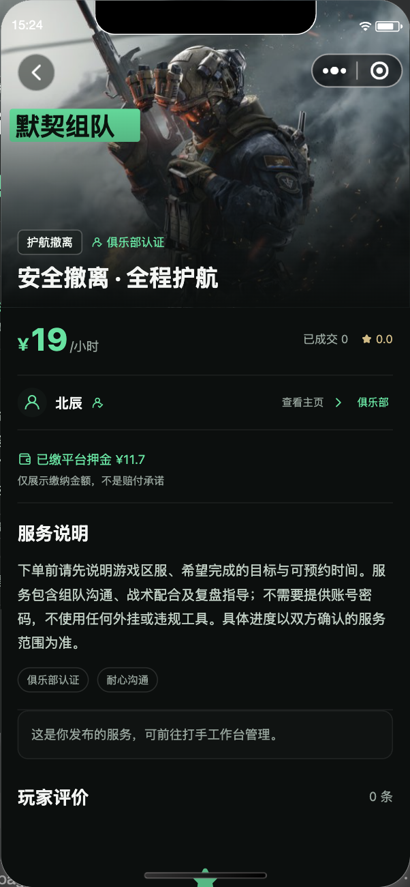
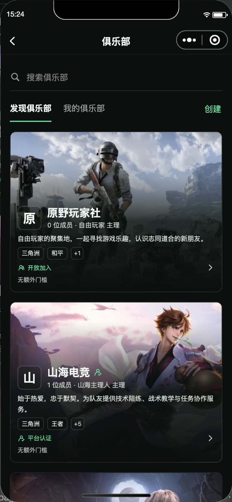
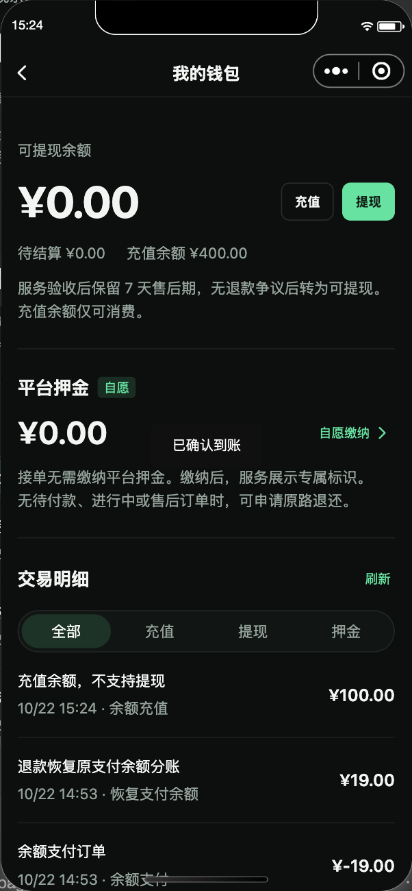
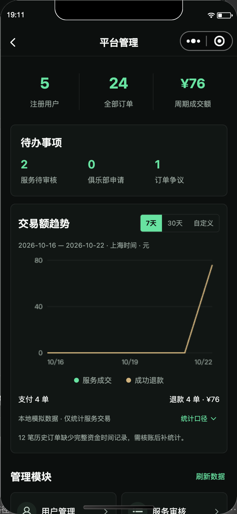

<!-- 文件作用：介绍开机电竞的定位、角色功能、技术架构、启动部署、验证边界与相关关键词。 -->

<div align="center">

# 🎮 开机电竞

### 多游戏陪玩 · 陪练接单 · 电竞俱乐部 · 服务交易平台

**从找队友、发布服务到订单交付，把玩家、接单者和俱乐部连接起来。**

[](frontend)
[](frontend/package.json)
[](frontend/package.json)
[](backend/go.mod)
[](deploy/compose.yml)
[](deploy/compose.yml)
[](LICENSE)

[项目介绍](#-这是什么项目) · [功能一览](#-功能一览) · [界面预览](#-界面预览) · [快速开始](#-快速开始) · [部署指南](docs/DEPLOYMENT.md) · [联系作者](#-联系作者) · [English](README.en.md)

</div>

---

## 👋 这是什么项目？

**开机电竞**是一套包含 **微信小程序客户端、H5 开发预览和 Go 后端**的多游戏服务交易平台源码。它面向想找队友的玩家、提供陪玩陪练与任务协作的接单者，以及组织成员开展服务的电竞俱乐部。

项目覆盖服务发布、需求撮合、下单付款、订单沟通、交付验收、评价、退款和平台介入，并提供钱包、俱乐部管理及平台运营后台。**业务页面、接口和数据存储都在这个仓库中**，可以用来学习完整交易业务，也可以在配置自己的微信、支付、域名及运营资料后继续开发。

> 🚧 **当前状态：** 核心业务与自动化测试已具备，H5 用于开发预览。真实微信账号、手机号授权、商户付款退款、转账到账、真实 AI 审核和微信发布仍需独立配置与验收，详见[验证与上线](#-验证与上线)。

### 谁可以使用？

| 角色 | 可以做什么 |
| --- | --- |
| 🕹️ 玩家 / 买家 | 浏览服务、发布需求、找队友、下单、沟通、验收评价、申请售后 |
| 🎧 接单者 / 打手 | 发布陪玩陪练服务、接需求、确认约定、交付服务、查看收入与订单 |
| 🏠 俱乐部负责人 | 创建和装修俱乐部、审核成员、管理团队服务及关联订单 |
| 🛠️ 平台管理员 | 审核内容、管理用户与游戏、处理纠纷、查看交易趋势、配置支付与 AI |

**一个账号可以同时发单和接单，加入俱乐部是可选项。** 平台管理与俱乐部管理入口均在客户端内。

## ✨ 功能一览

| 模块 | 已有能力 |
| --- | --- |
| 🎮 多游戏服务市场 | 游戏切换、主题配色、分类、搜索与排序、分页列表、服务详情和玩家主页 |
| 🖼️ 服务发布 | 封面选择、独立文字图层、标签与价格、发布审核、修改后重新审核 |
| 📣 需求与接单 | 玩家发布需求、自由接单、约定与价格快照、状态流转和权限校验 |
| 📦 订单履约 | 下单、付款、开始服务、交付、买家验收、完成评价 |
| 💬 四方订单沟通 | 买家、接单者、关联俱乐部负责人、平台管理员按权限参与文字与图片沟通 |
| 🛟 退款与纠纷 | 申请退款、同意或拒绝、补充证据、平台介入和裁决，保留订单与沟通记录 |
| 🏠 俱乐部 | 创建审核、成员申请、认证、游戏范围、图文主页、成员和关联订单管理 |
| 👛 钱包与押金 | 充值余额、服务收入、待结算、提现冻结分账；余额付款、自愿平台押金与原路退还 |
| 📊 运营后台 | 用户、服务、订单、俱乐部、游戏和审计管理；服务交易额与退款趋势 |
| 🤖 AI 内容审核 | 后端审核文字和图片、管理员配置兼容接口与模型、拒绝原因反馈、故障时保留填写内容 |
| 🔔 消息中心 | 系统通知、未读状态、按账号保存已读全文，与订单聊天证据分别管理 |
| 🔐 微信与安全 | 主动勾选协议、微信身份准备、手机号交易门槛、服务端权限、金额整数分、事务与幂等 |

### 一笔服务如何完成？

```text
浏览服务 / 发布需求 → 确认约定 → 下单付款 → 接单并开始服务
                                         ↓
完成评价 ← 买家验收 ← 提交交付 ← 订单内持续沟通
    └─ 遇到问题：申请退款 → 双方协商 → 必要时平台介入
```

### 支持哪些游戏？

内置 **13 款游戏目录与主题**，管理员可以调整分类、配色、封面、排序和上下架：

`三角洲行动` · `王者荣耀` · `和平精英` · `暗区突围` · `无畏契约` · `穿越火线手游` · `金铲铲之战` · `英雄联盟` · `无畏契约：源能行动` · `使命召唤手游` · `永劫无间手游` · `第五人格` · `蛋仔派对`

## 📱 界面预览

以下为**历史本地功能实屏，使用模拟数据**，展示服务、俱乐部、钱包和后台；它们不代表本轮实测或真实资金验收，当前界面以运行版本为准。

<table>
  <tr><th>服务详情与下单</th><th>俱乐部发现</th></tr>
  <tr>
    <td></td>
    <td></td>
  </tr>
  <tr><th>钱包与资金记录</th><th>平台运营后台</th></tr>
  <tr>
    <td></td>
    <td></td>
  </tr>
</table>

页面设计与说明位于 [design/pages](design/pages)，历史验收实屏保存在 [output](output)。

## 🧩 技术架构

| 层级 | 技术与职责 |
| --- | --- |
| 客户端 | uni-app、Vue 3、TypeScript、Vite、官方 uni-ui；微信小程序与 H5 构建 |
| API 服务 | Go 1.24、标准库 `net/http`；身份、交易、俱乐部、资金与管理接口 |
| 数据存储 | PostgreSQL 16 + pgx/v5；保存业务记录、交易证据和用户上传图片 |
| 缓存与会话 | Redis 7 + go-redis/v9；会话与限流 |
| 微信接入 | 微信登录、手机号、微信支付 APIv3、退款与回调、商家转账接口 |
| 内容审核 | 服务端调用兼容 Chat Completions 的图文模型接口，配置由管理员维护 |
| 部署 | Docker Compose、Nginx HTTPS 反向代理；游戏封面嵌入后端提供 |

```text
微信小程序 / H5 开发预览
          │ HTTPS API
          ▼
       Go 后端 ───── 微信身份 / 微信支付 / AI 审核
          │
          ├── PostgreSQL：业务、订单、资金账本、证据与图片
          └── Redis：会话与限流
```

### 仓库结构

```text
e-sports-platform/
├── frontend/       # uni-app / Vue 3 / TypeScript 客户端
├── backend/        # Go API、业务逻辑、测试与内嵌游戏素材
├── deploy/         # Docker Compose 与公开配置模板
├── scripts/        # 本地启停、构建与回归验收脚本
├── design/         # 页面设计、设计说明与历史版本
├── docs/           # API、部署、微信配置及功能验收资料
└── output/         # 按任务归档的验收报告与实屏记录
```

## 🚀 快速开始

### 1. 准备本地环境

本地启停脚本面向 **macOS**。准备 Go **1.24+**、Node.js 与 npm、Python 3、curl、lsof，以及可连接的 PostgreSQL 和 Redis。

| 依赖 | 开发模板默认值 |
| --- | --- |
| PostgreSQL | `127.0.0.1:5432`，专用开发数据库 `jijie_dev` |
| Redis | `127.0.0.1:56379` |
| API | `http://127.0.0.1:8090/api` |
| H5 预览 | `http://127.0.0.1:5173/` |

**请先创建开发数据库并启动 PostgreSQL / Redis。** 启动脚本只检查和复用依赖，不会替你创建数据库、启动容器或修改其他项目。连接账户等信息在本地配置中填写。

### 2. 获取源码并安装依赖

```bash
git clone --branch main https://github.com/hhh0078/e-sports-platform.git
cd e-sports-platform

# 安装前先检查镜像配置
npm config get registry
go env GOPROXY

# 需要时使用国内镜像
npm config set registry https://registry.npmmirror.com
export GOPROXY=https://goproxy.cn,direct

npm --prefix frontend ci
(cd backend && go mod download)
```

### 3. 配置并启动

```bash
cp backend/.env.example backend/.env
cp frontend/.env.example frontend/.env.local

# 按自己的开发数据库、Redis 和 API 地址修改上述配置后运行
./scripts/dev-start.sh
```

浏览器访问 **[http://127.0.0.1:5173/](http://127.0.0.1:5173/)**，健康检查为 [http://127.0.0.1:8090/health](http://127.0.0.1:8090/health)。日志位于 `.run/api.log` 和 `.run/h5.log`。

<details>
<summary>🧪 本地多角色体验与停止服务</summary>

| 身份 ID | 场景 |
| --- | --- |
| `player` | 买家下单、验收、退款 |
| `worker` | 打手发布、接单、交付 |
| `clubowner` | 俱乐部负责人管理成员和关联订单 |
| `admin` | 平台管理、审核、配置与裁决 |
| `outsider` | 验证无关用户与另一俱乐部的权限隔离 |

测试支付会标明“本地测试，不产生真实扣费”。开发身份与模拟支付在生产模式关闭。

```bash
# 先查看将停止的本项目进程
./scripts/dev-stop.sh --dry-run

# 停止本项目 API 与 H5，保留数据库和 Redis
./scripts/dev-stop.sh
```

</details>

## 🧪 验证与上线

### 自动化检查与构建

```bash
# 前端检查、测试和双端构建
npm --prefix frontend run typecheck
npm --prefix frontend run check:standards
npm --prefix frontend test
npm --prefix frontend run build:h5
npm --prefix frontend run build:mp-weixin

# 全套验收：需要可用的本地 PostgreSQL / Redis
# 包含 Go 真实数据库集成测试、竞态检查、静态检查及前端检查构建
./scripts/verify.sh

# 生成连接正式 API 的微信小程序发布包
./scripts/release-mini.sh
```

微信开发者工具导入 `frontend/dist/build/mp-weixin`。使用自己的 AppID，按发布指南配置 HTTPS 域名、隐私指引、运营主体及微信支付商户资料。

### 正式部署与验证边界

- 📦 **部署方式：** 后端、PostgreSQL、Redis 使用 Docker Compose，Nginx 提供 HTTPS；具体步骤见[部署指南](docs/DEPLOYMENT.md)。生产 Compose 与本地体验环境分别配置。
- 🧾 **版本状态：** 生产验收记录带有日期；2026-10-20 的生产记录属于历史快照，不能代表此后新增钱包、AI 审核、消息中心等功能已在生产通过。
- 📱 **真实能力：** 真人微信建号与协议同意、手机号授权、商户付款退款、转账到账、真实模型图文审核、手机真机及微信审核需分别验收。构建成功和本地模拟不替代这些结果。
- 🔑 **配置管理：** 只使用仓库中的 `.env.example` 作为模板，真实 `.env`、商户密钥、会话和数据库备份保留在私密环境。

品牌现统一为 **开机电竞**。`jijie` 等数据库、Go 模块、缓存键及部署资源名称属于兼容性技术标识；保留它们可沿用已有数据和配置，历史验收记录也保留当时名称。

## 📚 文档导航

| 想了解的内容 | 入口 |
| --- | --- |
| 源码部署、Docker、域名与回滚 | [部署指南](docs/DEPLOYMENT.md) |
| 微信身份、后台配置与支付接入 | [微信配置](docs/WECHAT_BACKEND_SETUP.md) |
| 钱包、押金、提现与测试 | [资金模块说明](docs/WALLET_SETUP_AND_TEST.md) |
| 平台控制台与交易统计 | [管理后台说明](docs/ADMIN_CONSOLE.md) |
| AI 审核与消息中心 | [审核和通知说明](docs/AI_MODERATION_MESSAGES.md) |
| 接口与后端测试 | [API 文档](docs/API.md) · [后端说明](backend/README.md) |
| 手动体验与角色验收 | [用户测试清单](docs/USER_TEST_CHECKLIST.md) |
| 演示数据生成与清理 | [演示数据说明](docs/DEMO_DATA.md) |
| 品牌更名与已有配置兼容 | [品牌更新记录](docs/BRAND_RENAME.md) |
| 页面设计、组件与开发要求 | [设计目录](design/README.md) · [开发规范](PROJECT_DEVELOPMENT.md) |

## 🤝 参与开发

欢迎通过 [Issues](https://github.com/hhh0078/e-sports-platform/issues) 反馈问题或讨论改进。参与前先阅读 [AGENTS.md](AGENTS.md) 和 [PROJECT_DEVELOPMENT.md](PROJECT_DEVELOPMENT.md)，说明复现步骤与影响范围，并为业务改动补齐相应验证。

## 📄 许可证与素材

源码许可证见 [Apache License 2.0](LICENSE)。游戏图片、图标等第三方资源的来源和使用边界另见[素材说明](docs/ASSETS.md)，其权利归各自权利人。

## 📬 联系作者

项目交流与合作，可通过以下方式联系：

| 联系方式 | 号码 |
| --- | --- |
| 📱 手机号 | [17607080935](tel:17607080935) |
| 💬 微信 | `17607080935` |

## 🔎 相关关键词

**电竞与游戏服务：** 开机电竞、电竞平台源码、电竞平台开源、电竞接单平台源码、电竞服务平台、游戏服务平台源码、游戏陪玩平台源码、游戏陪玩系统、游戏陪练系统、陪玩接单系统、陪练接单平台、游戏组队平台、游戏任务接单平台、电竞俱乐部系统、游戏俱乐部管理系统、陪玩俱乐部源码。

**小程序与交易系统：** 电竞小程序源码、陪玩小程序源码、陪练小程序源码、微信陪玩小程序、游戏接单小程序、多游戏服务小程序、服务交易平台源码、服务商城源码、需求发布系统、订单管理系统、订单聊天系统、退款售后系统、钱包充值提现、平台押金、平台运营后台、AI 内容审核。

**技术与二次开发：** uni-app 小程序源码、Vue3 小程序、TypeScript 项目、Go 后端源码、Golang 交易系统、PostgreSQL 项目、Redis 会话、Docker Compose 部署、微信登录、微信支付 APIv3、全栈开源项目、三角洲陪练平台、王者荣耀陪玩系统、和平精英陪练平台。

**English:** esports platform, esports marketplace, gaming services platform, game companion platform, game coaching marketplace, gaming club management, WeChat Mini Program, uni-app, Vue 3, TypeScript, Golang, PostgreSQL, Redis, order management, payment integration, open source.
