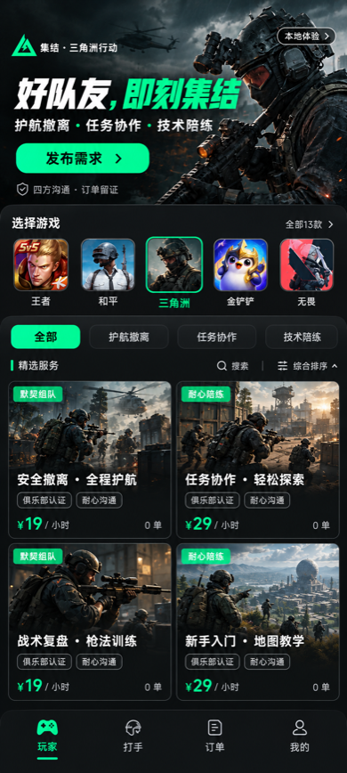
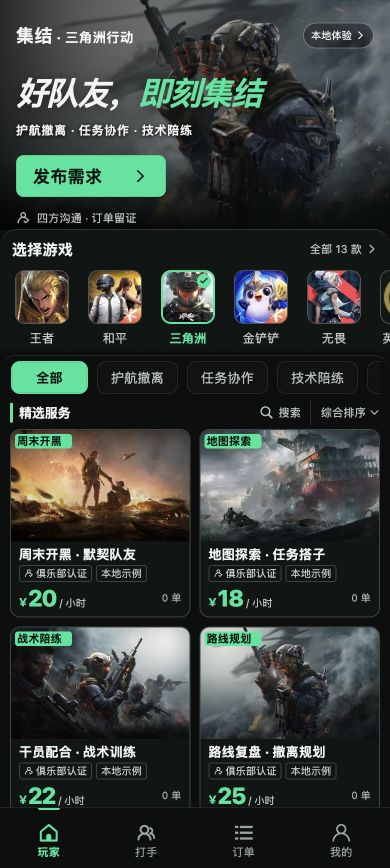
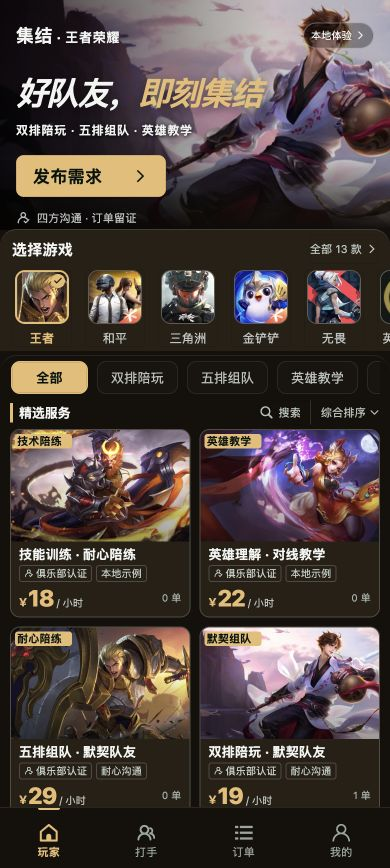

# 玩家首页与独立封面视觉验收

文件作用：记录 2026-10-18 本轮设计目标、实屏对照、修复迭代和验收范围。

final result: passed

## 比较对象和状态

- 用户原图：`docs/design-reference.png`，841×1870；设计目标：`docs/player-design-v2.png`，841×1870。目标图先于本轮 UI 实现生成，过程见 `docs/REDESIGN.md`。
- 两图均等比缩至 390×868，保留在 `output/redesign/reference-normalized.png`、`mock-normalized.png`。只做验收缩放，未将设计图拼成页面或用作游戏素材。
- 实现：`http://127.0.0.1:5173/#/`，H5 CSS 390×868、devicePixelRatio=1，截图同为 390×868。三角洲、全部分类、综合排序、搜索收起、无弹窗、页面顶部。
- 最终截图：`output/redesign/home-final.png`；王者 `honor-final.png`；窄屏 CSS 320×720 为 `home-320-final.png`。
- 原图、目标图、最终页面已放在同一次图像输入中比较，先查看全图，再以等比例版本重点检查主视觉、入口行、卡片标题/标签/价格。等比例图上的小字可辨认，不需要另裁局部图补判断。
- 微信真实模拟器：`output/redesign/mini-home-redesign.png`。截图包含模拟器状态栏、刘海、胶囊和安全区，不与 H5 作逐像素比较。页面使用真实胶囊位置留白，不绘制假状态栏。

| 设计目标 | 最终 H5 | 王者荣耀 |
| --- | --- | --- |
|  |  |  |

## 本轮发现与修复

| 级别 | 早先证据与影响 | 修复和复核 |
| --- | --- | --- |
| P1 | `output/redesign/before.png`：额外品牌栏和大段介绍挤占首屏，服务卡片密度与参考图差距明显 | 首页改为通栏主视觉、紧凑游戏入口、分类、双列卡片和四项底部导航；目标图与 `home-final.png` 的主区域比例接近 |
| P1 | 旧氛围插画无法确认具体游戏，尤其王者素材不符 | 逐款替换为官方页面/CDN素材；13图标、30封面全部有来源、尺寸、哈希清单；王者可识别李白/亚瑟/妲己/孙悟空 |
| P2 | 中间版默认三角洲强制滚到首项，王者与和平被隐藏 | 游戏条改为保留前两项的滚动位置；最终H5重载和微信实屏均显示王者、和平、三角洲、金铲铲、无畏首排 |
| P2 | 中间版主视觉横移后左侧出现硬黑边 | 图从left:0连续覆盖，宽度125%，保留右侧人物；最终图无硬黑条 |
| P2 | H5内置按钮默认自动边距影响入口和标签控制排列 | 在应用作用域覆盖按钮左右边距，320px/390px复核无页面横向溢出 |
| P2 | H5原生排序滚轮不适合直接鼠标点击 | 改为三项明确菜单；H5/微信实际点击价格、成交、综合，显示与后端顺序一致，菜单正常收起 |
| P2 | 封面位置选择不直观，长标签和宽英文有裁切风险 | 改为可展开九宫格；按完整字符组裁剪并为宽字预留空间，六条混合文案在全部九位置实测无重叠/越界 |

最终独立截图复核未发现剩余P0/P1/P2。上表中的历史问题已通过修复后截图和真实交互重新验证；旧截图仅保留为过程证据。

## 五项设计一致性检查

| 项目 | 最终检查 |
| --- | --- |
| 字体与层级 | 沿用系统中文字体，32px粗斜体主标题、17px行动按钮、13px卡片标题和较大的价格形成层次；不把生成稿中的字烤入图片。320px主标题降至27px，不折行遮挡人物；正文标签、金额均可读 |
| 间距与布局 | H5 hero 230px，与归一化目标稿230px一致；左右内容边距10–16px，双列卡片每列180.5px、间隔9px，游戏图标54px；底部导航固定且正文有底部留白。实际卡片来自数据库，与生成稿文案长度不同，保留正常纵向滚动 |
| 颜色与变量 | 三角洲实际计算样式为强调色 `#00E59B`、背景 `#0B0F0E`、面板 `#101614`；王者为暖金深棕。13款随配置切换；遮罩只用于文字可读性，无蓝紫渐变 |
| 图像与裁切 | 43张官方来源JPEG均实际加载，30封面+13图标共1,377,437字节。每款图标与底图独立；图片不拉伸，王者人物明确。真实官方题材取代生成稿虚构场景是为满足素材真实性要求，不要求人物姿势与生成稿相同 |
| 文字与内容 | 保留参考图的服务信息层级，使用真实标题、价格和成交数；不复制“9元保200万”等未建立的承诺，不虚构销量。四项导航按用户需求保留玩家/打手/订单/我的。官方游戏Logo不冒充平台Logo |

## 真实交互与双端检查

以下证据均位于 `output/redesign/`：

- 13游戏在390px和320px逐项切换，图像路径、加载和主题均核验；目录搜索“蛋仔”正确返回并切换。机器记录：`games-ui-checks.json`、`games-320-checks.json`。
- H5搜索“路线”、无结果、清空恢复、价格升序以及王者真实成交优先通过：`filter-sort-ui.json`、`search-empty.png`、`sort-menu.png`。
- 六文案服务通过实际发布、审核、重开编辑，底图/文本/颜色/背景/位置/尺寸逐项保持：`overlay-dom.json`、`overlay-persisted.json`、`overlay-reopened.png`；页面无Canvas。
- 微信最终构建的13游戏、三排序、目录搜索、换图保留全部文字样式、九宫格9个位置全部通过，运行异常0：`mini-redesign-smoke.json`；截图为 `mini-overlay-editor.png`、`mini-position-grid.png`、`mini-sort-menu.png`。
- 管理员独立图标通过真实文件选择器上传、保存、重开；四张封面与全部颜色未受影响：`admin-icon-ui.json`、`admin-icon-upload.png`。验收后精确恢复原内置图标。
- 当前H5控制台最后检查error/warn为空；微信两处自有代码已改用 `getWindowInfo`，最终回归未捕获异常。不以此宣称开发工具自身全部提示消失。

## 验收边界与后续微调

正式AppID、商户、域名、真机网络未参与本轮验证；真实登录、扣款、退款和提审仍需外部配置。本地微信模拟器与真实手机不同，不能用模拟器截图替代真机性能验收。

可后续微调（P3）：首页小标签在小尺寸卡片上刻意紧凑；如运营希望更多说明，应优先缩短文案，当前不阻断阅读或编辑。游戏排序是有来源的热门推荐，公开统计无法支持统一精确玩家数排行榜，口径见 `docs/GAME_POPULARITY.md`。

实施清单：设计稿先行、真实素材核对、P1/P2修复、等比例再比较、两端交互复测、保留截图、提供用户测试清单均已完成。业务与资金权限测试结果见 `docs/ACCEPTANCE.md`。
