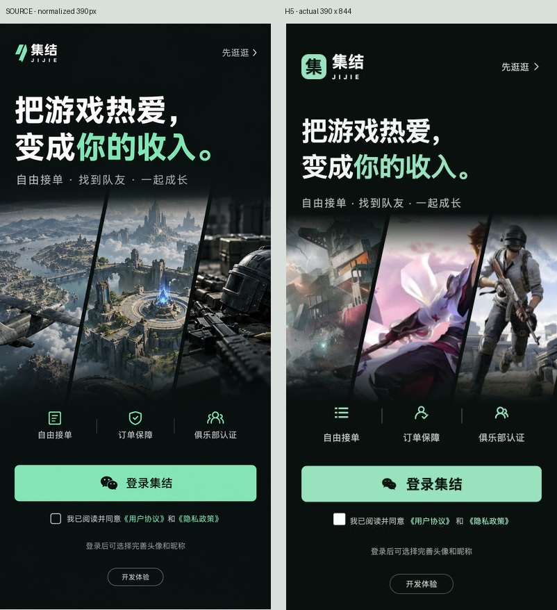
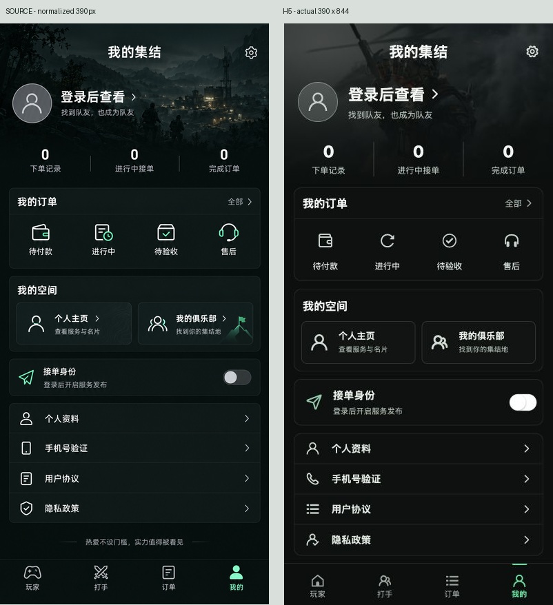
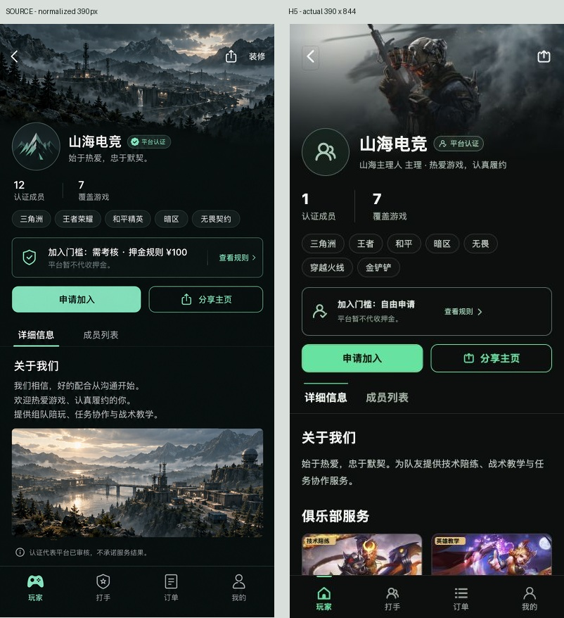

# 登录、访客页面与社区主页视觉验收

文件作用：记录2026-10-20本轮既有生成稿与真实H5的并排比较、问题修复、窄屏和访客交互证据。前轮导航验收保留在 [NAVIGATION_QA_PREVIOUS.md](docs/design/NAVIGATION_QA_PREVIOUS.md)，玩家页更早报告保留在 [PLAYER_QA_PREVIOUS.md](docs/design/PLAYER_QA_PREVIOUS.md)。历史报告的测试结果属于对应版本，不作为本轮通过依据。

final result: passed

## 比较依据

本轮沿用先前生成并实施的三张设计图；没有以网页截图代替设计稿。实际产品仍使用可辨识的官方游戏素材，图片上的服务标签由独立DOM定位，不烘焙进封面。

| 页面 | 源图 | 真实截图 | 同输入并排比较 |
| --- | --- | --- | --- |
| 登录 | docs/design/login-v2.png | output/community/login-final-390.png | output/community/login-comparison-final.jpg |
| 我的，访客 | docs/design/me-v2.png | output/community/me-guest-final-390.png | output/community/me-comparison-final.jpg |
| 俱乐部，详细信息 | docs/design/club-v2.png | output/community/club-final-390.png | output/community/club-comparison-final.jpg |

源图均853×1844，保持比例归一化为390×843；实屏为CSS 390×844、截图390×844、DPR=1，不包含浏览器边框。并排图左侧源图、右侧H5，两侧顶端对齐，只存在归一化取整产生的1px高度差。另保存每页的 `*-top-comparison.jpg` 和 `*-controls-comparison.jpg`，对比顶部至285px及475—790px的字体、图标、按钮、菜单和正文。

比较状态：登录未勾协议、无弹层；我的为访客、统计全部0、三角洲主题；俱乐部为公开访客、山海电竞、详细信息标签。俱乐部源图示例是负责人视角和示例内容，实屏按真实权限隐藏“装修”，真实成员1人、7款游戏、自由申请、无押金，未上传的图文不补造。该内容/权限差异明确排除逐像素比较；共同的封面、身份、认证、统计、游戏标签、加入规则、申请/分享和双栏结构均进行比较。

## 发现与修复历史

| 级别 | 最初发现 | 修复 | 复查证据 |
| --- | --- | --- | --- |
| P1 | 访客资料的禁用头像和更换封面按钮被uni默认灰态覆盖，出现突兀白底；profile-guest-final-320.png | 对两类禁用按钮显式设透明背景和主题弱文字色 | profile-guest-fixed-320.png，完整表单保留，禁用输入不再出现白色大块 |
| P2 | 登录开发体验按钮为全宽边框，偏离源稿的小型居中次要入口 | width:max-content，min-width:92px | login-final-390.png、login-final-320.png、login-controls-comparison.jpg |
| P2 | 俱乐部发现页320px标题末字单独掉行 | 强调短句独立成完整第二行并禁止句内折行 | clubs-final-320.png |
| P2 | 俱乐部主页320px的tabs负边距仍沿用17px，与小屏14px内容边距不一致，实际scrollWidth323 | 小屏左右负边距同步为14px | club-fixed-320.png，documentElement.clientWidth/scrollWidth均320 |
| P2 | GamePicker组件使用小程序不支持的类型选择器 | 5处改用显式class，保持原尺寸与布局 | GamePicker.vue；最终小程序产物和开发工具检查由主验收记录覆盖 |
| P2 | H5俱乐部规则/成员标签的text中嵌套Icon会触发跨端提示 | view-rules和member-cert改为view，保持样式类 | 最终俱乐部DOM已无uni-text直接嵌套组件；本轮日志保留修复前提示，不将其当作新错误 |

上述问题都在修后重新截图并查看。没有剩余阻断本轮视觉交付的P0/P1/P2。

## 五项一致性检查

- 字体与文案：使用现有PingFang SC系统中文字体与uni-icons。登录两行标题、薄荷强调、三项价值与协议区层级保留；真实文字可选取、可换行。生成图中的字形并非字体文件，实际UI的标题和菜单略大，优先保持可读性。长服务标题在320px自然分两行，无文字覆盖前后内容。
- 间距与布局：深色全宽封面、固定底部四导航与主体信息顺序符合稿件。个人中心保留全部菜单，访客没有登录墙；真实菜单触控区域较源图更高，底部格言可能需要纵向滚动。俱乐部7游戏标签按实际数量换行，认证徽标不收缩；窄屏tabs溢出已修。
- 颜色与状态：三角洲黑绿、王者深棕金色、金铲铲深色金黄随游戏配置变化。透明至实色遮罩只服务图片上文字可读性。未使用蓝紫渐变；禁用上传按钮已采用主题弱态。
- 图片与图层：登录三块斜切图实际为三角洲/王者/和平官方素材，取代生成稿中泛化的场景。我的及俱乐部默认复用当前游戏/俱乐部游戏封面；俱乐部图文由运营上传内容决定。ServiceCard复用渐变底部，标题/认证/价格置于图面，用户标签为absolute独立元素。
- 内容与图标：平台重点为自由接单、订单保障、俱乐部认证；保持稿件主要文案。生产能力、认证含义和押金提示按真实规则显示。生成稿的抽象Logo/线条图形使用当前品牌“集”与既有图标库，真实数量、成员和服务不为凑图替换。

这些是明确的产品/数据约束差异，本轮通过不表示与生成稿逐像素完全相同。

## 浏览器交互与响应式证据

本轮通过CUA操作应用内浏览器，使用当前本地前后端，未重置数据。所有截图均为真实渲染。先查看页面，再点击明确的可见控件。

1. 个人中心：访客头像和昵称显示“登录后查看”，三个统计为0；订单/空间/资料/手机号/协议菜单完整可见。390与320均页面宽=scrollWidth。截图me-guest-final-390.png、me-guest-final-320.png。
2. 登录：未勾协议点击登录只提示“请先阅读并勾选用户协议和隐私政策”，不建立会话。点击用户协议能公开阅读版本和正文，返回登录后仍需主动勾选。截图login-final-390.png、agreement-guest-final.png。此处未执行真实账号协议提交。
3. 订单：访客保留买卖身份与阶段筛选，仅用小字“请登录后查看”。320px筛选行在容器内横向滚动，底部导航可见，页面宽/scrollWidth均320。截图orders-guest-final-320.png。
4. 工作台：访客显示0统计、发布入口、我的服务/接单大厅和俱乐部入口，未被大登录按钮取代。320px无页面横溢。截图worker-guest-final-320.png。
5. 俱乐部：公开列表显示多俱乐部与多游戏，320px认证标签保持49px左右且nowrap。主页无需登录可读，规则弹层打开和关闭、成员标签切换、认证打手跳转个人主页均成功。截图clubs-final-320.png、club-fixed-320.png、club-rules-final.png、club-members-final-390.png。
6. 玩家主页：北辰公开主页显示35项服务，320/390均无页面横溢。截图player-profile-final-390.png、player-profile-final-320.png。
7. 复用封面：首页两列ServiceCard标题和价格覆盖图面，文字可在DOM独立读取。六文案服务在320px逐个读取边界，文案彼此无交集，仍有独立颜色/背景/位置，非合成图片。截图player-cards-final-390.png、service-six-labels-final-320.png。
8. 个人资料：访客仍显示头像、昵称、简介、封面各字段；输入均disabled、提示为小字。320px页面宽/scrollWidth均320。修后截图profile-guest-fixed-320.png。

浏览器error日志为空。检查中出现的uni-H5 text嵌套组件提示已通过两处容器替换处理；旧记录仍存在于同一预览日志，不据此宣称其为最终新错误。最终跨端包的编译与原生页面验收以主交付记录为准。本视觉检查不声称通过屏幕阅读器、手机真机手机号授权、最终真实微信会话或真实资金支付退款验收。

## 后续非阻断微调

- P3：规则弹层内容较少时72vh留白偏多，可在后续按内容自适应高度。
- P3：生成稿有定制纹理及俱乐部标识，当前采用真实官方封面和现有图标；如要专属品牌视觉，应另外制作正式品牌资产。
- P3：个人中心为了较大的菜单触控区域，格言下移到首屏外少量位置，四导航和全部实际功能正常。

实现检查单：三张源图已打开；同状态实屏已拍；三张全图及六张细节并排图已打开比较；P1/P2修复后已复拍；访客主路径、公开主页和320窄屏已交互验证；截图及历史验收保留；真实资金和真机授权范围未混入视觉通过结论。
