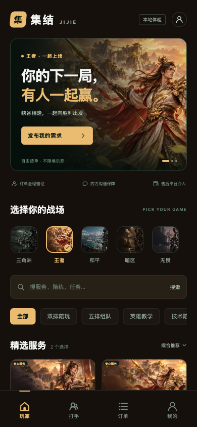
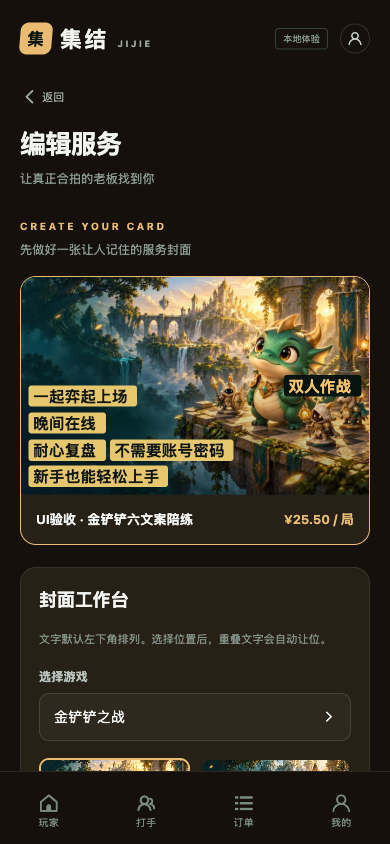
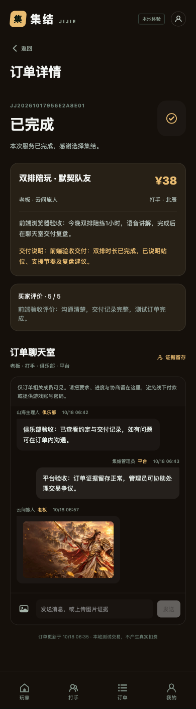
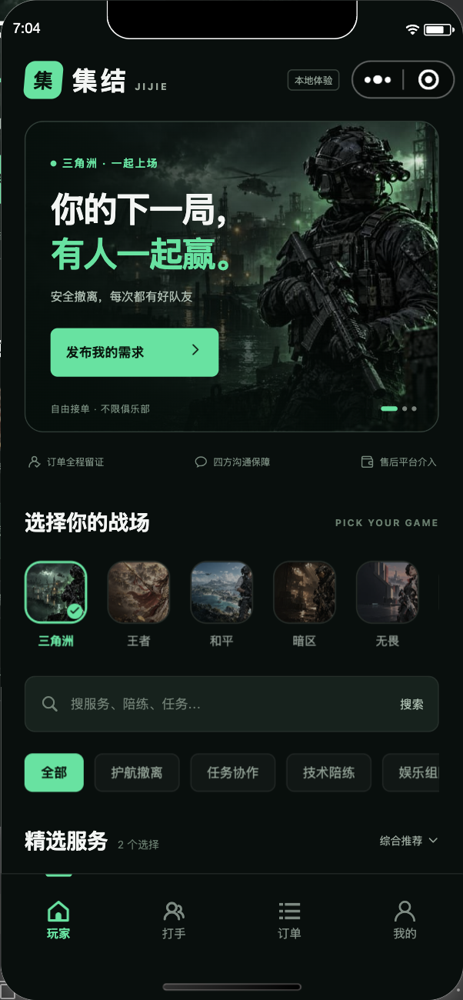
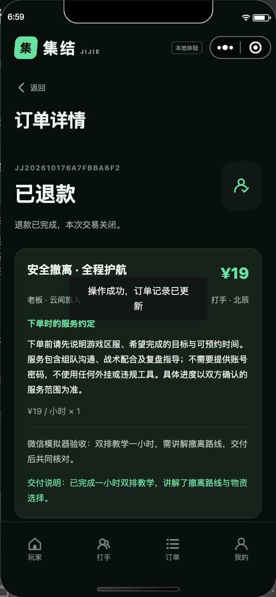
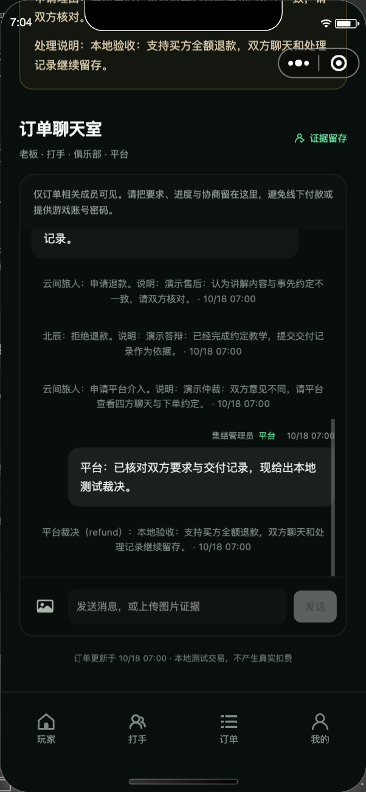

# 集结 · 本地版本验收结果

文件作用：区分代码测试、真实界面测试、运行状态和外部渠道待验收项。验收日期：2026-10-18。

## 结论

本地版本通过验收。四个角色可完成服务发布审核、下单履约、证据沟通、退款协商和平台裁决。H5 与微信小程序均实际运行过；不是仅编译通过。当前 API、H5、PostgreSQL 和 Redis 已运行，入口为 http://127.0.0.1:5173/。

真实微信身份、真实商户扣款/退款、分账提现、微信提审与真机网络没有正式资料，未宣称通过。本地开发身份与支付有明确标识；生产模式缺配置会明确失败，不会退回模拟成功。

## 自动化结果

| 项目 | 结果 | 证据 |
| --- | --- | --- |
| Go 真实集成测试 | 27 项通过，另含 3 个退款故障子场景；`-race` 无报告 | [后端记录](../backend/TEST_RESULTS.md) |
| Go 静态与编译 | `go vet ./...`、二进制构建通过 | `scripts/verify.sh`、`.run/verify.log` |
| 前端算法与格式测试 | 7 / 7 通过，含六条长文案九宫格避让、混合字号、默认前景对比、金额和资源路径 | `frontend/src/lib/*.test.js` |
| H5 与小程序构建 | 两端 production 构建通过；小程序构建约 0.84 MiB，包含全部 14 张封面 | `frontend/dist/build/` |
| 微信 UI 自动化 | 官方 SDK 实际操作五个身份，完整退款争议闭环通过，运行异常 0 | [机器结果](../output/playwright/mini-e2e.json)、[复现脚本](../scripts/mini-e2e.cjs) |
| 服务持久运行 | 实际停止/启动、重复启动复用、跨执行会话存活、健康检查 PG/Redis 均 ok | [启停脚本](../scripts/dev-start.sh) |

数据测试使用 `jijie_dev` 内随机独立 schema 与 Redis 键前缀，结束清理隔离夹具，不重置展示用数据。并发测试是正确性验证，不代表已做生产容量压测。

## H5 实际验收

- 390px 和 320px 手机宽度：首页无横向溢出；七款游戏逐项切换，主题与服务跟随变化。
- 玩家订单 `956e2a8e012cc855316e4ef5b16aba18`：下单数量 2、总价 38 元，支付、接单、开始、交付、验收、五星评价全部通过真实 UI 完成；服务详情能显示这条真实评价。
- 俱乐部负责人和平台管理员通过页面进入同一订单并发消息，身份标签正确。
- 使用真实文件选择器上传 800×500 JPEG 到该订单，图片加载成功，点击原图前重新申请签名并成功预览。
- 发布服务 `8f2027255b77a0097db037e613a7dee1`：六条文字、文字色、背景色、九宫格位置、25.50 元价格保存和回填正确；DOM 实测无重叠；管理员搜索、审核通过，修改后重新审核。
- 管理后台的游戏配置原值保存、审计留痕通过；没有借测试改坏种子主题。
- 无关账号访问订单时不展示订单和聊天；9 秒观察只有初次拒绝请求，没有继续轮询。
- 公开需求 `78696d2bbd64c679b71edc232a95a720`：玩家 UI 创建并付款，北辰选择山海电竞领取，负责人 UI 进入同一订单聊天室。该单保留“已接单”，可继续测试开始服务。见 [领取组织截图](../output/playwright/frontend-claim-club.png)。

| 首页 | 可配置文字封面 |
| --- | --- |
|  |  |

## 微信开发工具实际验收

环境：微信开发者工具 Stable 2.02.2608040，基础库 3.17.4，游客模式，本地 API。HBuilderX 已导入 `frontend`，微信工具打开 `frontend/dist/build/mp-weixin`。

成功订单：`6a7fbba6f2a4a8e52c3e3ce693166ad8`。

1. 云间旅人通过服务详情填写需求、下单、测试付款、发送文字。
2. 北辰接单、开始服务、发送文字、提交交付。
3. 山海主理人打开关联订单并发送俱乐部说明。
4. 买方申请退款，卖方拒绝并填写理由，买方申请平台介入。
5. 集结管理员阅读订单、发送平台说明、填写裁决依据，支持买方全额退款。
6. 页面显示“已退款”，系统事件留存；自由玩家访问该订单被拒绝，聊天室不渲染。

成功运行记录中的 `passed=true`、`runtime_exceptions=[]`。最终源码重新构建后，另验证带 next 登录回服务详情、不带 next 登录回“我的”、已退款状态和历史聊天，结果见 [最终构建冒烟](../output/playwright/mini-final-smoke.json)。截图与机器结果保存在 `output/playwright/mini-*`。

此前一次脚本运行遇到本地服务停启，页面保留输入并提示连接失败；另一次脚本没有等待裁决表单渲染，修复自动化等待后重新完整运行通过。这两次不计为通过证据。工具在重建输出目录时曾显示瞬时 app.json 缺失与游客 AppID 提示；最终产物存在、重新编译可运行。基础库的 API 弃用提示属于开发工具/uni 运行库提示，没有把它冒充为业务运行错误已全部消失。

| 微信首页 | 退款完成 |
| --- | --- |
|  |  |

## 关键回归

- 16 次并发支付只记录一次成功；20 次并发抢单只有一个胜者。
- 微信预支付与取消互斥，预支付结果未知仍保留付款意图；单数据库连接也能完成付款请求，不会嵌套借连接而阻塞。
- 退款先持久化稳定单号和冻结状态，再调用外部渠道；三种退款入口模拟超时均能安全恢复。
- 退款异常保持资金冻结；伪造通知、金额/付款人/商户/流水不匹配、重复通知均有验证。
- 公共需求只返回白名单字段，完整需求和支付信息不泄漏；角色与金额不能由客户端伪造。
- 历史聊天支持 before/after 游标；120 条历史和 150 条新增不会因为分页丢失；图片续签重新验证订单权限。
- 多俱乐部隔离、挂靠审核、退出撤销展示认证、历史订单组织快照、冻结账户立即失效。
- 后台搜索在数据库分页前执行，验证首屏 100 条以外的数据仍可查询。

发现与修复详情见 [独立审计记录](REVIEW.md)。没有已知尚未处理的本地 P1/P2 阻断项。

## 交付边界

- 资金使用整数分，当前提供全额退款；收入是订单汇总，不是打手可提现的钱包。正式商户分账/出款还须按资质选通道并联调。
- 聊天采用四秒增量轮询，不含语音通话、视频或微信模板消息。文字、图片和系统事件在 PostgreSQL 留存。
- 原创游戏氛围封面不包含官方 Logo；游戏名称用于区分服务，正式运营需按实际类目、游戏规则及素材授权审核。
- 当前 Git 仓库无远程地址，只完成本地中文提交；不宣称已推送云端。

开始人工体验请看 [USER_TEST_CHECKLIST.md](USER_TEST_CHECKLIST.md)，重启与开发方式见 [README](../README.md)。
