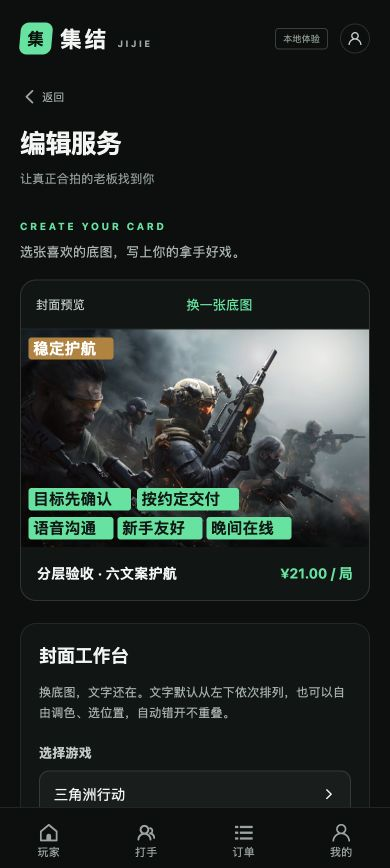
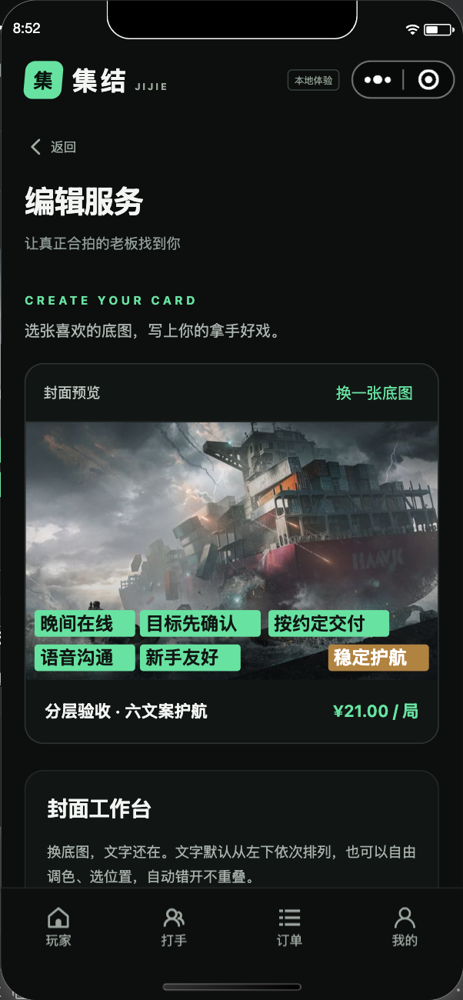

# 集结 · 本地版本验收结果

## 2026-10-18：其余三个导航按图改版

先生成并保存 [打手](design/navigation-worker.png)、[订单](design/navigation-orders.png)、[我的](design/navigation-me.png) 三张图，再据图实现。源图/实屏的逐轮对照及修复见 [design-qa.md](../design-qa.md)，三页总览见 [实际页面](../output/navigation-design/navigation-actual.jpg)。

- 打手页改为游戏主题工作台、真实统计、服务分组；保留暂停/待审和独立封面文字，20条分页至38项全部显示。
- 订单页读取角色/阶段深链，SQL先筛选后分页，卖方待支付不出现付款动作；停用游戏使用订单游戏名快照。
- 我的页按图重排，资料限制和后端一致；计数与路由一致，俱乐部入口正确mine=1，管理员权限保留。
- 修复跨会话迟到资料/401覆盖、旧读取覆盖接单开关、WXSS不兼容选择器和320px溢出。含query的主导航也重置页面栈。

本轮实测：Go真实PG/Redis集成与race（38项顶层+21子场景）、vet、前端33项测试、H5/微信构建全部通过。微信导航报告 [mini-navigation-report.json](../output/navigation-design/mini-navigation-report.json) passed=true；profile原始字段及开关恢复；运行异常与console_errors为空。H5记录 [h5-checks.json](../output/navigation-design/h5-checks.json)。

微信新订单 `103e0d5caebc5ab88ea9d5505cd3c16f` 完整走通支付→接单→开始→交付→四方聊天→退款申请→打手拒绝→平台介入→全额退款，陌生账号无权访问。详见 [交易报告](../output/playwright/mini-e2e.json)。这里的支付退款均为本地测试，不扣真实款。

本轮以前的验收与历史业务边界保留如下。

文件作用：区分当前代码测试、真实界面验收、历史证据与外部渠道待验收项。更新日期：2026-10-18。

## 本轮结论

本轮已按用户参考图先生成设计目标，再修改首页并进行等比例实屏比较。13款游戏使用各自官方来源图标/封面；新增服务随机匹配底图，文字保留为独立可编辑图层。H5和微信开发者工具均有真实操作证据，详见根目录 [design-qa.md](../design-qa.md)。

当前 API、H5、PostgreSQL 和 Redis 已运行。入口：[集结本地体验](http://127.0.0.1:5173/)。这是本地可用版本，真实微信身份、商户扣款/退款、分账提现、微信提审与真机网络未完成正式渠道验收。生产模式缺少配置会明确失败，不会退回测试付款成功。

## 当前版本验证结果

| 项目 | 实际结果 | 证据 |
| --- | --- | --- |
| Go真实PG/Redis测试 | 35项顶层测试、21个子场景全部通过；race无报告 | [后端记录](../backend/TEST_RESULTS.md)、[原始JSON](../output/redesign/backend-tests.json) |
| Go静态与构建 | `go vet ./...`和二进制构建成功 | 后端记录与可复现命令 |
| 前端测试 | 12/12通过；六条最长文案、混合字号/九宫格/emoji/宽英文、默认排列、随机换图、空值边界、金额/资源地址 | `cd frontend && npm test` |
| H5与微信最终构建 | 两端production构建成功；微信目录145个文件、1,978,226字节（1.8866 MiB，小于2 MiB） | `frontend/dist/build/`，未把素材来源清单打进小程序 |
| 官方素材核对 | 13游戏、30封面、13独立图标；43个JPEG哈希/尺寸/大小与清单一致，共1,377,437字节 | [来源](ASSETS.md)、[清单](assets-manifest.json) |
| H5实屏 | 390px和320px下13游戏、主题、图像加载、目录搜索、服务筛选/空结果、三排序通过；最后console error/warn为空 | `output/redesign/games-*.json`、`filter-sort-ui.json`及截图 |
| H5独立文字 | 六文案实际发布、审核、重新进入编辑，底图和全部文案样式/位置一致，换图不丢文字，Canvas数量0 | `overlay-dom.json`、`overlay-persisted.json`、`overlay-reopened.png` |
| H5管理员 | 独立图标实际文件上传、保存、重开；颜色和四张封面不变。验收后精确恢复原内置图标 | `admin-icon-ui.json`、`admin-icon-upload.png` |
| 微信视觉与编辑 | 最终构建实际操作13游戏、首排、目录搜索、三排序，六文案九宫格9位置无重叠/越界，换图保持全部样式；运行异常0 | [机器结果](../output/redesign/mini-redesign-smoke.json)、[脚本](../scripts/mini-redesign-smoke.cjs) |
| 微信四方交易 | 新建订单、测试支付、接单、开始、交付、四方聊天、退款申请/拒绝/介入/裁决、陌生人拒绝，全部通过；运行异常0 | [机器结果](../output/playwright/mini-e2e.json)、[脚本](../scripts/mini-e2e.cjs) |

数据集成测试在 `jijie_dev` 内建立随机独立schema和Redis键前缀，不重置本地展示数据。并发测试证明业务正确性，不代表生产容量压测。当前前端测试有Node模块类型提示，构建与测试成功；未为消除此无害提示调整整项目模块制式。

## 视觉与封面重点

| 三角洲真实首页 | 王者真实首页 | 六条独立文字回填 |
| --- | --- | --- |
|  |  |  |

默认游戏顺序为热门推荐：王者、和平、三角洲、金铲铲、无畏契约、英雄联盟、源能行动、CF手游、暗区、使命召唤手游、第五人格、永劫手游、蛋仔。各来源的DAU/峰值/收入指标不能直接当作统一玩家数排名，具体依据见 [GAME_POPULARITY.md](GAME_POPULARITY.md)，管理员可以改排序。

三角洲与王者各有4张底图，其余各2张。`cover_url` 与 `labels` 分开保存；`image` 与独立文字层分开渲染，无Canvas烘焙。标签默认左下依次向右，空间不足换行；改位置后自动避让。编辑已有服务保留原图；切游戏随机取该游戏图，换底图保留全部文字配置。

新六文案样本：`9d6fbce4bae12a9e94a3e3d1e1e9aa57`，标题“分层验收 · 六文案护航”。已暂停，防止测试商品占据演示首页；北辰可在我的服务继续编辑。

管理员配置和历史数据保护已有测试：只迁移明确的旧默认图，不覆盖自定义主题、封面、服务内容/金额/标签或历史订单快照；有管理员保存记录的游戏主题不自动覆盖。本机本轮改色和新增封面通过管理员接口显式保存。

## 微信最终实测

环境：微信开发者工具Stable 2.02.2608040、基础库3.17.4、游客模式、本地API。导入目录 `frontend/dist/build/mp-weixin`；HBuilderX已导入 `frontend`。

最新四方退款订单：`b21ee0a617daedcd3bc68664c4696f98`，2026-10-18 08:37（北京时间）完成。

1. 云间旅人填写约定、下单、测试付款，发送老板消息。
2. 北辰接单、开始、发送打手消息、提交交付。
3. 山海主理人进入关联订单、发送俱乐部消息。
4. 买方申请退款，卖方拒绝，买方申请平台介入。
5. 集结管理员核对约定和四方证据、发送平台消息、支持买方退款。
6. 页面显示已退款、系统事件保留；自由玩家访问被拒绝，不渲染聊天室。

本轮最终视觉与图文脚本于08:52在重建后通过；其中价格/成交/综合三排序逐张比较页面标题、分价和成交数与后端响应。自有代码的系统尺寸读取已改用 `getWindowInfo`。不将业务异常0等同于开发工具自身全部警告消失。

| 微信首页 | 文字编辑 | 退款完成 |
| --- | --- | --- |
|  |  |  |

早先图文脚本因SDK不能跨uni-app自定义组件查询而超时，另有一次按钮文案匹配错误；均修正为按真实组件路径和可见文案操作后完整重跑。`mini-redesign-failure.png`仅是历史脚本失败截图，不计作成功证据。构建中瞬时app.json缺失、游客AppID限制与页面业务错误分开记录，最终构建已可实际运行。

## 上一轮保留的完整业务证据

以下是改版前的同一后端流程实测，不冒充本轮逐步重跑；本轮后端完整回归与微信新订单已覆盖其核心调用链。

- H5正常完成订单 `956e2a8e012cc855316e4ef5b16aba18`：数量2、38元，支付→接单→开始→交付→验收→五星评价；真实UI上传800×500 JPEG，图片可续签预览，四方聊天可回读。
- 旧六文案服务 `8f2027255b77a0097db037e613a7dee1`：价格25.50元、保存回填、审核与修改重审通过。
- 公开需求 `78696d2bbd64c679b71edc232a95a720`：玩家创建付款，北辰选择山海电竞领取，负责人进入该订单沟通。保留已接单状态，可继续测试。
- 服务停止/重启、重复启动复用PID、跨执行会话存活、PG/Redis健康检查均实际执行过；本轮源代码更新后重新启动，数据库保留。

## 重要业务回归

- 16次并发付款只成功记账一次；20次抢单只有一个成功。
- 预支付与取消互斥，未知结果保留付款意图；单数据库连接的付款与俱乐部创建/编辑均不因嵌套借连接而阻塞。
- 退款先保存稳定退款号和冻结状态，三入口上游超时均可恢复；金额、商户、付款人、流水、重复回调与验签均有协议测试。
- 四方聊天、陌生人隔离、私密截图与续签权限；120条历史与150条增量无分页丢失。
- 多俱乐部成员审核、退出/移除游戏撤销新认证；历史订单按原组织快照授权。公开需求使用字段白名单。
- 130条服务及80条隐藏/冻结记录覆盖完整数据集搜索和分页排序；三种排序跨页无遗漏重复，拒绝未知排序。
- 前端不再通过自由标签伪造“俱乐部认证”；退出或移除支持游戏后，当前展示和新订单权限一致撤销。

完整测试范围与独立复核见 [TEST_RESULTS.md](../backend/TEST_RESULTS.md)、[REVIEW.md](REVIEW.md)。

## 交付边界

- 当前全额退款、四秒增量轮询聊天；没有语音视频通话、微信模板消息、部分退款或可提现钱包。收入为订单统计。
- 真实微信登录、实际商户扣款/退款、分账提现和真机网络需正式资料后联调，本地流程不替代这些验收。
- 新素材来自官方公开页面/CDN，来源可追溯；公开可下载不等于取得商业使用授权，正式运营授权边界见 [ASSETS.md](ASSETS.md)。
- 当前仓库没有Git远程，只能完成本地中文提交，不能宣称已推送云端。

人工体验请按 [USER_TEST_CHECKLIST.md](USER_TEST_CHECKLIST.md)，启动方式见 [README](../README.md)。
