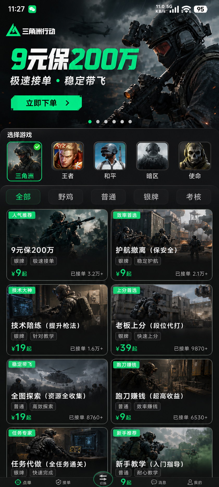

# 界面验收

文件作用：记录参考图的采用方式与真实界面检查证据。2026-10-18。

参考是用户提供的三角洲服务大厅截图，采用其深色背景、绿色情绪、游戏封面和图片文字标签方向。项目并非逐像素复制：增加四个主导航、俱乐部与平台管理、四方证据聊天，并扩展七种游戏配色。

| 输入参考 | 真实小程序界面 |
| --- | --- |
|  |  |

| 检查项 | 实际结果 |
| --- | --- |
| 游戏主题 | 七款游戏逐项点击验证，背景/强调色/封面随选择变化，无蓝紫渐变 |
| 手机适配 | H5 390px、320px 无横向溢出；微信模拟器实际渲染 |
| 微信导航 | 按胶囊实际位置留白，顶部头像在小程序隐藏，避免遮挡 |
| 封面文字 | 最多六条，九宫格锚点、字号、前景背景可编辑；纯函数边界测试及真实 DOM 矩形检查无重叠 |
| 文字对比 | 浅色默认标签使用深色文字；用户自定颜色保留 |
| 空白与异常 | 空列表、加载、无权访问、断网均有提示，提交失败保留输入 |
| 交易详情 | 下单约定、金额、参与者、状态、交付、退款和沟通分区可辨认 |
| 管理操作 | 审核、游戏配置、审计记录在小程序内完成，关键状态变更先显示确认框 |

验收状态：通过。构建与业务测试的范围、实测截图以及真实微信能力的外部依赖见 [ACCEPTANCE.md](ACCEPTANCE.md)。
